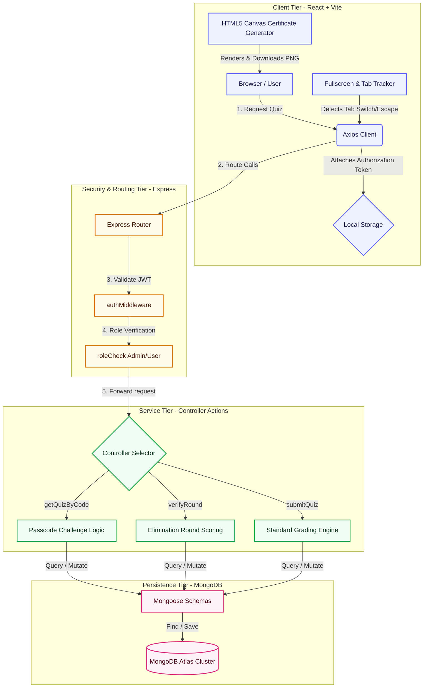

# Quizora: Technical Architecture & Interview Prep Guide

This guide provides a detailed overview of the Quizora platform's architecture, data flows, core technical stack, and a comprehensive set of interview questions to help you explain and defend this project in technical interviews.

---

## 1. System Architecture & Flowchart

The following flowchart illustrates the end-to-end data lifecycle of the application—from the candidate interaction in the browser to state changes in the database.

---

## 2. Working Explanation of the Stack

### Frontend: React.js (Vite)
- **Vite Development Engine**: Replaces traditional webpack to enable lightning-fast hot-module replacement (HMR) and optimized rollup production bundles.
- **Client-Side Routing**: Handled by `react-router-dom` to implement clean paths like `/quiz/:code/instructions` and `/admin/quiz/:id/questions`.
- **Global Context state**: `AuthContext.jsx` manages user credentials, keeping authentication persistent using `localStorage` synchronization.
- **HTTP client**: Custom instance of `axios` configured with automatic request/response interceptors to attach authorization headers (`Bearer <token>`) and capture `401 Unauthorized` responses for automatic token refresh or logouts.

### Backend: Node.js + Express
- **RESTful API Architecture**: Organized using router modules (e.g., `quizRoutes.js`, `submissionRoutes.js`) map endpoint requests directly to controller functions.
- **Custom Authentication Middleware**: Inspects the incoming request's HTTP headers, parses the JWT token, verifies its signature against the `JWT_SECRET`, and attaches the loaded database `User` object directly to the request (`req.user`) for downstream routing actions.
- **Role Access Policies**: Inline route verification helpers reject non-administrator requests dynamically before database transactions run.

### Database: MongoDB + Mongoose ORM
- **NoSQL Document Database**: Document objects map naturally to complex nested JSON structures (e.g., questions containing variable answer options and grading rules).
- **Mongoose Schemas**: Models enforce structure (types, defaults, validators) on NoSQL records, and manage relationship mapping (e.g. `Submission` references the `User` schema and `Quiz` schema).

---

## 3. High-Tier Features Breakdown

### A. Strict Fullscreen Anti-Cheat Protocol
1. **Consent Trigger**: The user must check a box agreeing to strict anti-cheat conditions before starting.
2. **Browser Lock**: On mounting `QuizAttempt.jsx`, the client calls `document.documentElement.requestFullscreen()` to engage fullscreen.
3. **Event Listeners**:
   - `fullscreenchange`: Fired if the candidate exits fullscreen manually.
   - `visibilitychange` (or `window.onblur`): Fired if the candidate switches tabs or minimizes the window.
4. **Violation Counter**: If a violation event occurs, a modal overlay blocks the quiz interface. If the count reaches 3, the frontend automatically submits the quiz as disqualified.

### B. Elimination (Multi-Round) System
1. **Dynamic Grouping**: Questions are assigned a `round` index. The frontend dynamically splits questions into rounds.
2. **Isolated Environment**: Candidates can only see and answer questions belonging to their current active round.
3. **Round Submission & Grade Check**:
   - Clicking "Submit Round" posts the round's answers to `/api/submissions/verify-round`.
   - The backend counts correct answers. If the candidate fails to score $\ge$ the admin-defined `passingPercentage` for that round, the backend creates an eliminated submission record immediately and returns `{ eliminated: true }`.
   - The user is immediately kicked to the results page, marked as **Eliminated**, and access to chained follow-up quizzes is blocked.

### C. Sequential Chaining & Passcode Protection
- **Sequential Quizzes**: Admin links Quiz A to Quiz B by providing the code of Quiz B as Quiz A's `nextQuizCode`. Upon passing Quiz A ($\ge$ cutoff), a success banner displays a "Start Next Quiz" button which routes to Quiz B's instructions.
- **Passcode Challenges**: If a quiz is password-protected, attempting to fetch it will return a `403 Forbidden` status with a `requirePasscode: true` payload. The user is prompted with an interactive card to input the password before they can view instructions or attempt the quiz.

---

## 4. Key Interview Questions & Answers

### Q1: How did you implement authentication and secure sensitive routes?
**Answer**:
> "Authentication is implemented using JSON Web Tokens (JWT). When a user logs in, the backend signs a JWT payload containing their ID and role. The frontend stores this token in localStorage and attaches it to the Authorization header of all API calls using an Axios request interceptor.
> On the backend, an authentication middleware verifies the JWT, retrieves the user from the database, and stores it in the Express `req.user` context. Specific routes (like creating/updating quizzes or viewing global statistics) are protected by a `roleCheck('admin')` middleware which checks `req.user.role === 'admin'` and returns `403 Forbidden` if validation fails."

### Q2: Why did you choose a NoSQL database like MongoDB for this application instead of PostgreSQL?
**Answer**:
> "Quizzes and questions are highly document-centric. A single quiz can have multiple rounds, varying question counts, and diverse structures (e.g. some questions have explanations, some are in specific rounds).
> In a NoSQL document database like MongoDB, we can query a quiz and populate all its associated questions using simple, fast lookups. The schema-less nature also lets us easily extend fields—like adding custom `round` markers to questions and `passingPercentage` to quizzes—without complex SQL migrations. It maps perfectly to JSON objects, which speeds up API payload construction."

### Q3: What is an Axios Interceptor, and how did you use it here?
**Answer**:
> "An Axios Interceptor intercept requests or responses before they are handled by `then` or `catch`.
> In this project, we used two:
> 1. **Request Interceptor**: Grabs the token from localStorage and appends it to the header of every outgoing request as a Bearer token.
> 2. **Response Interceptor**: Monitors API responses. If a `401 Unauthorized` is returned (indicating the session token has expired), the interceptor automatically clears localStorage and redirects the user to the login page."

### Q4: In your passcode verification, you changed the HTTP status code from 401 to 403. Why?
**Answer**:
> "Initially, when a user entered a passcode-protected quiz with no passcode (or an incorrect passcode), the backend returned `401 Unauthorized`. However, the frontend Axios interceptor is designed to treat any `401` response as a signal that the session token has expired, resulting in an automatic logout and redirect to `/login`.
> To prevent this, I changed the passcode verification failure status code to `403 Forbidden` with a custom payload `{ requirePasscode: true }`. This keeps the user logged in, bypasses the session-expiry handler, and cleanly prompts the passcode entry modal on the frontend."

### Q5: How does the anti-cheat system work technically? What prevents candidates from bypassing it?
**Answer**:
> "The anti-cheat relies on native browser Web APIs:
> 1. **Fullscreen API**: Forces the page into fullscreen using `requestFullscreen()`. Any attempt to exit fullscreen throws a `fullscreenchange` event.
> 2. **Page Visibility API**: Detects if the user switches tabs, shifts focus to another window, or minimizes browser windows by listening for the `visibilitychange` and `window.blur` events.
> When either event fires, we increase a violation counter. Once the violation counter reaches 3, the frontend calls the auto-submit grading controller API immediately, preventing further cheating attempts."

### Q6: How does the backend calculate round-by-round elimination?
**Answer**:
> "Instead of standard submissions where grading happens at the very end, elimination mode calls `/api/submissions/verify-round` after each round. The backend fetches the questions for that specific quiz, filters for questions belonging to the completed round, and grades the user's responses.
> It retrieves the quiz's `passingPercentage` (set by the admin) and compares the round's score against it. If the user fails to meet the cutoff, the backend immediately creates an eliminated submission record (`isEliminated: true`), saves it to the database, and returns a response containing `eliminated: true`. The frontend immediately terminates the quiz and redirects them to the result view."

### Q7: If a user refreshes the page during the instructions screen of a chained quiz, how do they stay authorized?
**Answer**:
> "In React, component state (`location.state`) is lost on page refresh. To prevent blank screens or authorization bypasses, the `QuizInstructions` component checks for missing state in `useEffect` and fetches the quiz details directly from the API using the quiz code in the URL.
> If the API returns a passcode challenge status code (`403` with `requirePasscode: true`), the instructions screen renders a secure passcode prompt. This ensures that the user remains authenticated and verified, even on hard refreshes."

### Q8: How did you implement the high-resolution certificate download?
**Answer**:
> "We used the HTML5 Canvas API. When a user scores $\ge 80\%$ on the results page, a certificate generation button becomes active.
> When clicked, the application creates a virtual `<canvas>` element in memory, uses the Canvas 2D context to draw a professional design (complete with gold borders, watermarks, custom typography, dynamic score details, and platform signatures), and exports it to a base64 Data URL using `canvas.toDataURL('image/png')`. Finally, it creates a virtual link element, sets the download attribute, and clicks it programmatically to prompt the download."
